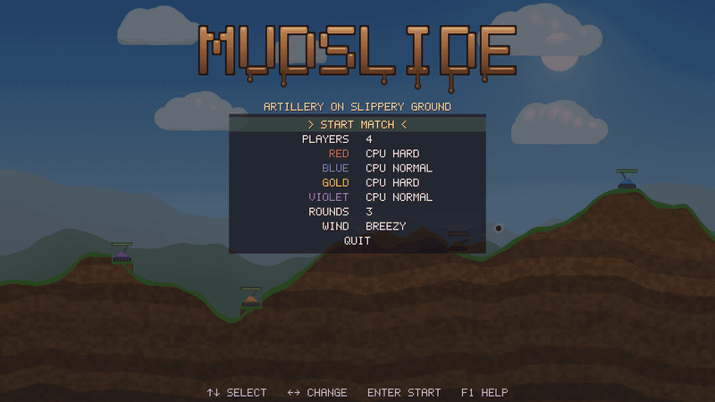
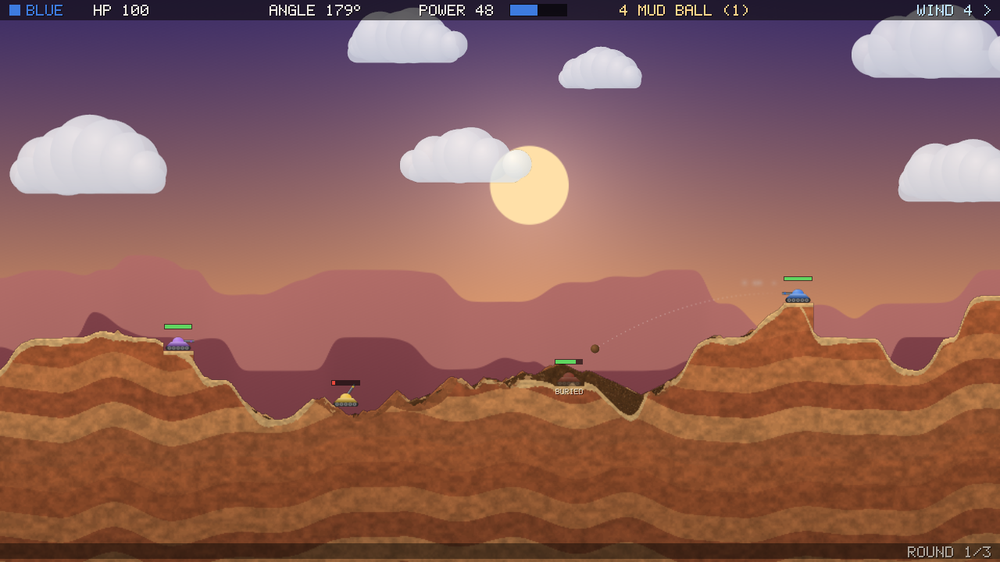

# Mudslide



A turn-based artillery duel written in C++17 with SDL2. Two to four tanks sit
on rolling hills and take turns firing at each other. You set the barrel angle
and the shot power, then let gravity and the wind do the rest.

The ground is loose. Every blast throws real clods of dirt into the air, and
where they land they pile up as loose soil that slides down slopes. Wet mud
slumps further still. Craters undercut hillsides, which then collapse, and
tanks fall into the holes. A well-placed mud ball can bury an enemy so deep
that its shots have to drill their way out.

All the art (terrain, sky, tanks, logo, app icon) and every sound effect is
generated by code, so the game ships with no asset files.

A sharper 720p version of the clip above is in
[docs/gameplay.mp4](docs/gameplay.mp4).

## How to play

| Key | Action |
| --- | --- |
| Left / Right (or A / D) | Turn the barrel (hold to keep turning; it speeds up) |
| Up / Down (or W / S) | Shot power |
| Shift + the above | Fine adjustment |
| Tab, Q / E, 1-4 | Choose a weapon |
| Space or Enter | Fire |
| Esc | Pause (resume or quit to the menu) |
| M | Sound on / off |
| F11 or Alt+Enter | Toggle fullscreen |
| F1 | Show or hide a keyboard legend (pauses the match while open) |

Players take turns on one keyboard. Each turn the wind shifts a little. The
HUD shows its strength and direction, and the clouds drift with it. While you
aim, your previous shot is drawn as a faint dotted line, so you can correct
from it.

### The menu

The menu runs a computer-only match in the background. Use **Up / Down** to
pick a line and **Left / Right** to change it:

* **Players:** 2 to 4.
* **Red / Blue / Gold / Violet:** Human, CPU Easy, CPU Normal or CPU Hard,
  for each player.
* **Rounds:** 1, 3, 5 or 10.
* **Wind:** Off, Calm, Breezy or Gale.

Your choices are saved in `settings.ini` in the per-user folder SDL picks
(on Windows, `%APPDATA%\Mudslide\Mudslide\`).

### Rules

* Every tank starts a round with 100 HP. Damage is highest at the centre of a
  blast and falls off toward its edge. A direct hit does full damage.
* Tanks fall when the ground under them is blown away. A long fall hurts.
* A tank at 0 HP blows up at the end of the shot. That explosion carves a
  crater and damages its neighbours, so chain reactions happen.
* **Buried tanks** are drawn as a ghost with a *BURIED* tag. If the muzzle is
  inside dirt, the shell drills a tunnel out and loses speed for every pixel
  of dirt it passes through.
* The last tank standing wins the round. Kills are credited to whoever
  caused them, including chain reactions and falls. The match goes to the
  most rounds won, then the most kills. Each round is a fresh map with one
  of four themes: Green Valley, Red Canyon, Frost Ridge and Moon Bog.

### Weapons



| # | Weapon | Ammo per round | What it does |
| - | --- | --- | --- |
| 1 | Shell | unlimited | A standard explosive round: radius 22, up to 34 damage. |
| 2 | Heavy Shell | 2 | A big blast: radius 44, up to 58 damage. Throws a lot of dirt around. |
| 3 | Cluster | 2 | Bursts into five bomblets at the top of its arc. Each has radius 15 and does up to 20 damage. |
| 4 | Mud Ball | 3 | Lands as a heap of wet mud (radius 36) and splashes the rest of its volume around it, so the whole ball always ends up on the ground. The mud slides down slopes and buries what it covers. A direct hit stings for 10. |

### Computer players

A CPU tank picks a target (Easy: anyone; Normal: the nearest; Hard: the most
damaged) and a weapon that suits it. It then searches about a thousand
angle and power pairs, simulating each shot with the game's own ballistics,
wind included. The search runs in small slices while the turret turns, so it
never stalls a frame. The difficulty decides how much aiming error is added
to the best shot found. The error shrinks with every shot at the same target,
like a player correcting their aim.

## How the terrain works

The world is a 960 x 540 grid of cells. Each cell is air or a coloured grain:
rock strata, topsoil, loose soil or mud (`src/core/terrain.cpp`).

* An explosion clears a disc. About 85% of the removed grains are thrown out
  as clods that fly ballistically, wind included; the rest is blasted to
  dust. Most clods are slow and land within a couple of crater widths,
  building a raised rim. A few fly much further.
* A clod that hits the ground deposits all its grains as **loose soil**.
* After every shot the terrain settles. Grains with nothing beneath them
  fall. Loose soil also slides down anything steeper than 45 degrees, and
  mud down anything steeper than about 27 degrees.
* Settling only rescans columns near something that changed, so a whole
  collapsing hillside still runs in real time.
* The match logic runs in fixed 1/120 s ticks with its own seeded random
  generator. Everything is deterministic and needs no SDL, so the tests can
  play whole matches headlessly.

## Building

You need CMake 3.16+, a C++17 compiler and SDL2 (2.0.10 or newer). If CMake
cannot find SDL2, it downloads and builds it automatically. Turn that off with
`-DMUD_FETCH_SDL=OFF`.

**Windows (Visual Studio + vcpkg):**

```sh
cmake -S . -B build -DCMAKE_TOOLCHAIN_FILE=%VCPKG_ROOT%/scripts/buildsystems/vcpkg.cmake
cmake --build build --config Release
build\Release\mudslide.exe
```

`vcpkg.json` makes vcpkg install SDL2 automatically. `SDL2.dll` is copied next
to the executable, and the procedurally drawn icon is embedded in the `.exe`.

**Linux:**

```sh
sudo apt install build-essential cmake libsdl2-dev   # or your distro's equivalent
cmake -S . -B build -DCMAKE_BUILD_TYPE=Release
cmake --build build -j
./build/mudslide
```

**macOS:**

```sh
brew install cmake sdl2
cmake -S . -B build -DCMAKE_BUILD_TYPE=Release
cmake --build build -j
./build/mudslide
```

The game has been built and tested on Windows only. The Linux and macOS steps
use only SDL2 and the standard library, but have not been tried yet.

### Windows release and itch.io

`tools/release_windows.sh` builds a self-contained release: SDL2 and the C++
runtime are linked statically (vcpkg triplet `x64-windows-static`), so players
need no DLLs or Visual C++ redistributable. It runs the tests, checks the
`.exe` imports only system DLLs, stages `dist/mudslide-<version>-windows/`
(the game, a player readme, licenses and an `.itch.toml` launch manifest) and
zips it. Given an itch.io project, it also uploads the folder to the
`windows` channel with [butler](https://itch.io/docs/butler/):

```sh
tools/release_windows.sh                     # build, test and package only
butler login                                 # once
tools/release_windows.sh your-name/mudslide  # ... and upload
```

The version comes from `project(Mudslide VERSION ...)` in `CMakeLists.txt`
and is shown on the menu.

## Tests

`mud_tests` checks the simulation without opening a window:

* Terrain generation is deterministic. Settling never loses or creates a
  grain and always comes to rest.
* Ballistics: a vertical shot reaches the expected height and comes back down
  on the shooter. Mirrored shots are symmetric.
* With aiming error turned off, a CPU's first shot hits the target in at
  least 85% of 40 random maps, at every wind level.
* A human turn driven through the input calls lands a mud ball on the enemy,
  uses up ammo, splashes clods and buries the target.
* A heavy shell fired into open ground: at least 75% of its crater must land
  again as loose soil.
* Several full CPU matches of 2 to 4 players each play through to the end.

```sh
ctest --test-dir build -C Release
build/Release/mud_tests 20        # play 20 full matches instead of 6
```

## Command-line options

```
--size WxH             window size (default 1280x720)
--screenshot FILE.bmp  play CPU turns offscreen, save one frame and exit
--scene NAME           menu | aim | flight | blast | debris | settle | round | over |
                       pause | help | cover
--seed N               match seed (screenshots default to 12345; --record and the
                       cover default to the best of 160 auditioned seeds)
--players N            CPU players for --screenshot (2-4, default 4)
--turns N              turns to play before capturing (default 3)
--human                make player 1 human (captures their first turn)
--record FILE|-        play the showcase clip, writing raw RGB24 frames ("-" = stdout)
--fps N                frame rate for --record (default 30)
```

For example, the weapons screenshot is
`mudslide --screenshot shot.bmp --scene flight --seed 2 --turns 6`.

### Regenerating the clip and the cover

`tools/make_media.sh` makes `docs/gameplay.mp4` (1280 x 720, 30 fps),
`docs/gameplay.gif` (800 px wide, 15 fps) and `docs/cover.png` (1280 x 640,
the size GitHub uses for a repository's social preview). Both videos are
encoded from the same lossless recording. You need bash and ffmpeg with
libx264.

```sh
tools/make_media.sh                    # uses build/Release/mudslide or build/mudslide
tools/make_media.sh path/to/mudslide
```

Both use a four-CPU showcase match. Before recording, the game plays the
opening 25 seconds of 160 candidate seeds headlessly and keeps the one that
packs in the most: a mud ball, a heavy blast, a cluster burst, a tank
falling, a shot drilling out of dirt and a tank destroyed, preferably on a
daytime map. Matches are deterministic, so the recording replays exactly what
was auditioned. The clip starts on the menu, adds captions on the first mud
ball and heavy blast, and never touches your settings. The cover catches the
first blast after the mud ball has landed, with the logo over it.

## Layout

```
src/core/   terrain, match rules and ballistics, computer players (no SDL dependency)
src/gfx/    software rasterizer, procedural art and themes, 5x7 pixel font (no SDL dependency)
src/app/    SDL2 game: menu, input, rendering and effects, synthesized audio, settings
tools/      icongen (app icon as a Windows .ico at build time), make_media.sh (clip and cover),
            release_windows.sh and release/ (Windows package and itch.io upload)
tests/      headless simulation tests
docs/       gameplay.mp4, gameplay.gif, cover.png, screenshot.png
```
